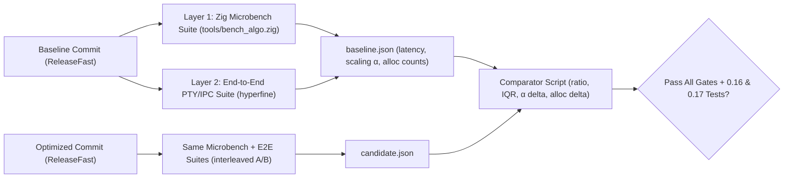

# Algorithmic Performance Improvement Plan & Empirical Benchmark Methodology

> [!NOTE]
> **Implemented in `v0.12.0` (revs `839`–`845`):** Phases 0 through 5 below have been implemented, benchmarked against the `v0.11.1` baselines in `docs/development/benchmarks/`, and verified across Zig 0.16.0 and 0.17.1 (`1,112/1,112` tests passing, including follow-up fixes `#564` and `#565`).

This document defines a staged, evidence-driven plan to eliminate the highest-impact algorithmic and hot-path bottlenecks identified in `szn` as of v0.11.1, together with an empirical benchmark methodology that proves each optimization delivers measurable improvements without regressions on either **Zig 0.16.0** or **Zig 0.17.0** (verified locally on 0.16.0 and 0.17.1).

For previously completed rev 371–38X performance work, see [Performance & Optimization Opportunities](improvements.md). For reflow semantics that must remain invariant, see [Text Reflow](../text_reflow.md).

---

## 1. Executive Summary & Priority Matrix

| Priority | Workstream | Primary Symbols | Current Complexity / Cost | Target Complexity / Cost | Impact |
|---|---|---|---|---|---|
| **P0** | Text reflow & copy-mode entry | `Grid.rewrap`, `Grid.reflowCursorInternal`, `Pane.enterCopyMode`[^src-grid] | Two $\Theta(N^2 / W)$ loops + $O(L \log W)$ per-line reallocs + unconditional full reflow on copy-mode entry | $O(N)$ time, $1$ allocation per wrapped output line, zero-copy skip for unwrapped rows | Eliminates resize/copy-mode freezes on long Thai, numeric, and high-scrollback panes |
| **P1** | Non-blocking I/O queue drains | `Server.flushDisplayClient`, `flushStdout`, `Pty.flushInput`, `MessageReader.consume`[^src-io] | $\Theta(N^2 / C)$ `copyForwards` shifts on partial writes (up to ~32 GiB moved for one 8 MiB sixel in 1 KiB chunks) | $O(N)$ amortized via head-offset `ByteQueue` | Eliminates CPU spikes & backpressure stalls over slow PTY/SSH/mosh links |
| **P1** | Sixel refcount & per-cell render scan | `Screen.hasSixelImages`, `Screen.decrementMainGridRef`, `Screen.incrementCellRef`, `Display.renderAll`[^src-screen] | 64-slot (~3.6 KiB) scan **before** 1-bit `cell.attr.sixel` check on hot VT paths; $O(W \cdot H \cdot 64)$ scan per sixel frame | $O(1)$ bit check + `active_sixel_count: u8`; $O(64)$ precomputed containment mask per pane | Eliminates ~700 KiB wasted reads per `CSI K` line clear and speeds up all UTF-8 output |
| **P2** | PTY read-to-render cadence & split borders | `Pane.feedPty`, `runServerDaemon`, `Server.renderToDisplayClient`, `Display.drawLayoutBorders`[^src-render] | 1 render cycle + $N_{\text{win}}$ `tcgetpgrp` syscalls per 4 KiB read; `drawLayoutBorders` marks every split row dirty, defeating row-skip | Bounded PTY drain budget (e.g. 64–256 KiB), throttled `tcgetpgrp`, diff-guarded border writes | Dramatically raises bulk output throughput and restores row-granular render skipping on split windows |
| **P3** | Secondary algorithmic cleanups | `Screen.insertLines`/`deleteLines`/`scrollUp`/`scrollDown`, `char_width.charWidth`, `status.buildLine`[^src-misc] | $O(n \cdot H) = O(H^2)$ row shifts; override linear scan before ASCII fast path; $O(W^2)$ `orderedRemove` | $O(H)$ `std.mem.rotate`; ASCII check / min-override guard; $O(W)$ slice truncation | Removes remaining super-linear edge cases |

---

## 2. Empirical Benchmark Methodology

The existing [bench.sh](https://github.com/cwt/szn/blob/main/bench.sh) harness only measures cold startup latency, session create/destroy throughput, and idle RSS memory for 1/10/50 panes. It does **not** exercise reflow scaling, backpressure I/O drains, VT/UTF-8 ingestion, or split-pane bulk rendering.

To guarantee that every optimization genuinely works (and does not trade complexity for hidden overhead), all phases use a **two-layer empirical benchmark protocol** executed **before** (`baseline`) and **after** (`candidate`) each phase.



### 2.1. Layer 1 — Deterministic Zig Microbenchmark Harness

Add a standalone benchmark executable wired via `zig build bench -Doptimize=ReleaseFast` (e.g., `tools/bench_algo.zig`, zero runtime impact on the `szn` binary):

- **Monotonic timing (dual 0.16/0.17 safe):** Use `std.c.clock_gettime(.MONOTONIC, &ts)` (or a shared shim in [compat.zig](https://github.com/cwt/szn/blob/main/src/compat.zig)) rather than version-divergent `std.time` APIs so identical benchmark code compiles and runs on both Zig 0.16.0 and Zig 0.17.0.
- **Anti-DCE barrier:** Feed benchmark outputs (e.g., final line count, checksum of rendered bytes, cell count) into `std.mem.doNotOptimizeAway(...)` so LLVM cannot elide work in `ReleaseFast`.
- **Sampling protocol:**
  - 5 unmeasured warmup iterations to stabilize caches, branch predictors, and lazy `libthai` initialization.
  - Minimum **30 measured iterations** (or ≥1.5 seconds per case, whichever is larger), recording raw nanosecond durations to compute **median**, **p95**, **p99**, and **IQR (p75 − p25)**.
- **Asymptotic Scaling Slope (Doubling Test):**
  For every complexity fix, measure geometrically scaled problem sizes $N \in \{N_0, 2N_0, 4N_0, 8N_0\}$ and compute the empirical exponent:
  $$\alpha = \log_2\!\left(\frac{\text{median}(2N)}{\text{median}(N)}\right)$$
  - A true quadratic bottleneck exhibits $\alpha \approx 2.0$ ($4\times$ time when $N$ doubles).
  - A verified linear fix exhibits $\alpha \approx 1.0$ ($2\times$ time when $N$ doubles).
  - Using $\alpha$ makes the complexity proof **hardware-independent**: even on a busy laptop, $\alpha$ dropping from $\approx 2.0$ to $\approx 1.0$ across $4\times$–$8\times$ size increases is unmistakable.
- **Deterministic Allocation & Copy Counters:**
  Wrap the backing allocator in a `CountingAllocator` (`std.mem.Allocator` vtable wrapper) during a dedicated non-timed counter pass to record exact:
  - `alloc_calls`, `resize_calls`, `remap_calls`, `free_calls`
  - `total_bytes_allocated` and `peak_live_bytes`
  - For I/O queue drains, explicitly count `total_bytes_memmoved` (bytes shifted by compaction).
  These counters are **100% deterministic** (zero timing noise).

### 2.2. Layer 2 — End-to-End Macrobenchmark Suite

Extend benchmarking (via a companion script such as `tools/bench_throughput.sh` using `hyperfine --export-json`, preserving [bench.sh](https://github.com/cwt/szn/blob/main/bench.sh) intact) to measure full-stack `szn` behavior:

1. **Bulk VT/UTF-8 streaming throughput:** Stream 10 MiB of mixed ASCII + SGR color + UTF-8 box-drawing + `CSI K` sequences into an attached 2×2 split-pane `szn` session and measure wall time until completion marker appears (`capture-pane` or sentinel output).
2. **Interactive resize latency on populated scrollback:** Fill a pane with 2,000 lines (including wrapped Thai and numeric lines), send a sequence of 20 alternating `resize` packets (120→60→100→40→...), and measure total wall time and server CPU time (`getrusage` / `ps`).
3. **Copy-mode entry latency:** Enter and exit copy mode 20 times on a pane with 2,000 history lines.
4. **Slow-consumer backpressure relay:** Pipe a 4–8 MiB sixel frame through a rate-limited PTY/socket (e.g., throttling reader to 4 KiB/read with `pv` or a Python pacing harness) and measure server + client CPU time (`user + sys` from `rusage`).

### 2.3. Experimental Controls & Reproducibility Rules

1. **Build parity:** Always compile with `-Doptimize=ReleaseFast` and separate clean caches per toolchain:
   ```sh
   rm -rf .cache .zig-cache
   zig build bench -Doptimize=ReleaseFast --cache-dir .cache/bench16
   ```
2. **Interleaved A/B execution:** Save the baseline binary (`bench-baseline`) and candidate binary (`bench-candidate`), then alternate runs (`A, B, A, B, ...`) to cancel CPU thermal throttling and OS background noise.
3. **Host metadata capture:** Every JSON result file records git/hg revision, Zig version (`zig version`), OS/arch, CPU model, `libthai` availability, and timestamp.
4. **Regression check against existing benchmarks:** Re-run [bench.sh](https://github.com/cwt/szn/blob/main/bench.sh) after the final phase to verify startup time and idle RSS memory do not regress.
5. **Dual-toolchain correctness gate:** Before any optimization is accepted, both **Zig 0.16.0** and **Zig 0.17.0** must pass:
   - `zig fmt --check .`
   - `zig build test -Doptimize=ReleaseFast` with **zero failures and zero leaks** (remembering Zig 0.17's non-reusing `SafeAllocator` catches any UAF immediately, per `AGENTS.md`).

---

## 3. Detailed Optimization Plan

### Phase 0 — Baseline Measurement Infrastructure (Pre-Optimization)

**Goal:** Establish immutable baseline numbers before changing a single line of algorithm code.

- **Deliverables (when implementation begins):**
  - `tools/bench_algo.zig` + `bench` step in [build.zig](https://github.com/cwt/szn/blob/main/build.zig)
  - `tools/bench_compare.py` to diff two JSON runs (median speedup, IQR overlap check, scaling exponent $\alpha$, deterministic allocation counter delta)
  - Saved baseline JSON artifact (`baseline-v0.11.1.json`) for both Zig 0.16.0 and Zig 0.17.0/0.17.1
- **Gate:** Every benchmark case runs deterministically, produces valid JSON, and empirically confirms the predicted baseline scaling exponents ($\alpha \approx 2.0$ for `rewrap_thai_breaks`, `reflow_numeric_dots` at $N \ge 64\text{k}$, and `out_buf` partial drain).

---

### Phase 1 (P0) — `Grid.rewrap()` & `Grid.reflowCursorInternal()`

**Target files & symbols:**
- [src/grid.zig](https://github.com/cwt/szn/blob/main/src/grid.zig#L571-L1242): `Grid.findClusterEnd`, `Grid.clusterWidth`, `Grid.rewrap`, `Grid.reflowCursorInternal`
- [src/thai.zig](https://github.com/cwt/szn/blob/main/src/thai.zig#L803-L868): `thai.findWordBreaks`
- [src/window.zig](https://github.com/cwt/szn/blob/main/src/window.zig#L226-L238): `Pane.enterCopyMode`

#### Root Causes Verified in Source

1. **Quadratic `word_breaks` scan (`rewrap`):** On every wrap, `wb_idx` resets to `word_breaks.len` and walks linearly backward past every break in the rest of the logical line ($\Theta(N^2 / W)$).
2. **Quadratic number-length scan (`rewrap`):** `while (end_idx < cells.len and isNumberChar(cells[end_idx].char))` scans to the end of the entire contiguous number/dot/comma run on every wrap, even though it only checks `num_len <= 6` ($\Theta(N^2 / W)$).
3. **Unconditional & backward Thai/Lao space scan (`rewrap`):** Every wrap on a non-space walks `j` backward from `i` to `line_start` checking `thai.isThaiOrLao` ([src/grid.zig](https://github.com/cwt/szn/blob/main/src/grid.zig#L745-L766)) — even when a logical line contains zero Thai/Lao characters, and even on Thai/Lao lines where the most recent valid space boundary could have been tracked during the forward pass.
4. **Per-line allocation churn & `+50%` capacity over-allocation (`rewrap` & `reflowCursorInternal`):** Each physical line starts with `line_cells: ArrayList(Cell) = .empty` and triggers 5–7 reallocations as clusters append; `reflowCursorInternal` allocates a fresh `page_allocator` scratch arena (`mmap`/`munmap`) and destroys/recreates every line even for single-row non-wrapped lines. Similarly, `thai.findWordBreaks` starts `codepoints` and `cell_indices` `.empty` and reallocates $\sim 2\log_2 N$ times before calling `th_brk_wc_find_breaks`.
5. **Duplicate `charWidth` lookups:** `findClusterEnd` and `clusterWidth` both invoke `char_width.charWidth(cp)` for every cell.
6. **Copy-mode `forceReflow()` overhead:** `Pane.enterCopyMode` unconditionally runs `forceReflow()` across the entire scrollback even when width has not changed and zero lines in `history`/`lines` are soft-wrapped (`line.wrapped == true`).

#### Planned Algorithmic Changes

1. **Monotonic / binary-searched `word_breaks` lookup ($O(N)$ total):**
   - Because `line_start` strictly increases each outer iteration, maintain a lower bound `wb_lo` advancing past `line_start`, and binary-search `wb_hi = std.sort.upperBound(usize, word_breaks[wb_lo..], i, ...)` in $O(\log B)$ (handling any backtracking cleanly), then scan backward only within `word_breaks[wb_lo .. wb_lo + wb_hi]`.
2. **Bounded $O(1)$ number-length check:**
   - Cap the forward `end_idx` scan at `end_idx - start_idx <= 6` (stopping after at most 7 cells). The `else` comma-search branch already only inspects `[start_idx, i)` on the current line.
3. **Skip Thai/Lao-only rules on non-Tai lines & track `space_wb` forward in $O(1)$:**
   - Compute `has_thai` (U+0E00–U+0E7F) and `has_tai` (U+0E00–U+0EFF, covering Lao too) in a single pass; skip all Thai/Lao rules (space boundary, right-attaching mark, Thanthakhat, Mai Han Akat, and Thai look-ahead) when `!has_tai`.
   - When `has_tai` is true, track `last_tai_space_wb: ?usize = null` incrementally in $O(1)$ during the forward cluster loop whenever a non-padding space bordering a Thai/Lao character (and not followed by `isThaiRightAttaching`) is appended, eliminating the backward `while (j > line_start)` scan completely.
4. **Eliminate per-line reallocation, avoid `growCapacity` slack, & optimize `findWordBreaks`:**
   - Return `{ end: usize, width: u32 }` from a combined `nextCluster(cells, start)` helper so `charWidth` is called once per cell.
   - Pre-size each `line_cells` once with **`try line_cells.ensureTotalCapacityPrecise(allocator, new_width)`** (do **not** use `ensureTotalCapacity`, which calls `growCapacity` and over-allocates every 120-cell line to 188 cells, wasting +57% memory / ~2.2 MiB per 2,000-line pane).
   - In `thai.findWordBreaks` ([src/thai.zig](https://github.com/cwt/szn/blob/main/src/thai.zig#L815-L833)), pre-size `codepoints` and `cell_indices` once via `ensureTotalCapacityPrecise(allocator, cells.len + 1)` (using the caller's scratch allocator where possible) and only pass contiguous Thai-containing spans into `th_brk_wc_find_breaks`.
5. **Two-tier fast path for unmodified single physical lines in `reflowCursorInternal`:**
   - **Tier A — Whole-grid no-op fast path on `forceReflowCursor` (`new_width == self.width`):** During the initial scan of `history` and `lines`, check whether any row has `line.wrapped == true`. When `new_width == self.width` and `!any_wrapped`, every logical line in the grid is already a single physical row of width $\le \text{self.width}$ that cannot wrap; clamp `out_cursor_x`/`out_cursor_y` and return immediately in **$O(H + V)$ time with zero allocations, zero cell copies, no `scratch_arena` creation, and full preservation of trailing BCE background cells**.
   - **Tier B — Per-line buffer transfer when some lines are wrapped:** For any standalone physical line (`!prev_wrapped and !line.wrapped`) whose trimmed content fits within `new_width` and requires no intra-line wrap, transfer ownership of its existing `GridLine.cells` buffer directly into `new_lines` (`old_line.cells = .empty`, resizing/padding in place only if `new_width != self.width`) instead of flattening into `flat_cells` and allocating a new `ArrayList(Cell)`.

#### Empirical Benchmarks & Pass/Fail Gates

> [!NOTE]
> **Separating `rewrap` lookup complexity from `libthai` C dictionary latency:** Empirical profiling on `ReleaseFast` shows that at $N = 32\text{k}, W = 16$, `Grid.reflow` takes ~14.1 ms total, of which `libthai`'s `th_brk_wc_find_breaks` C call takes ~12.8 ms (~91%) and the quadratic `wb_idx` loop in `Grid.rewrap` takes ~1.3 ms. To prevent Amdahl's law inside `libthai.dylib` from masking the Zig complexity fix, we benchmark both the isolated `rewrap` word-break loop (up to $N = 128\text{k}$) and end-to-end `Grid.reflow` with live `libthai`.

| Case ID | Input Workload | Scaling Sizes | Primary Metrics | Acceptance Gate |
|---|---|---|---|---|
| `rewrap_thai_breaks` | `Grid.rewrap` on a single logical line of Thai cells using precomputed/synthetic `word_breaks` at $W=16$ (isolating Zig `rewrap` from C `th_brk_wc_find_breaks`) | $N \in \{16\text{k}, 32\text{k}, 64\text{k}, 128\text{k}\}$ cells | Median ms, scaling $\alpha$ | $\alpha \le 1.15$ (down from $\approx 2.0$); $\ge 15\times$ faster at $N=128\text{k}, W=16$ |
| `reflow_thai_e2e` | Full `Grid.reflow` on repeated Thai prose with live `libthai` active at $W=16$ and $W=40$ | $N \in \{4\text{k}, 8\text{k}, 16\text{k}, 32\text{k}, 64\text{k}\}$ cells | Median ms, scaling $\alpha$, `alloc_calls` | $\alpha \le 1.15$; $\ge 3\times$ fewer allocs in `findWordBreaks` + `rewrap`; faster across all $N$ |
| `reflow_numeric_dots` | Single logical line of digits/dots (`"1234567890."` repeated) reflowed to $W=40$ | $N \in \{16\text{k}, 32\text{k}, 64\text{k}, 128\text{k}, 256\text{k}\}$ cells | Median ms, scaling $\alpha$ | $\alpha \le 1.15$ (down from $\approx 2.0$ at $128\text{k}\to 256\text{k}$); $\ge 15\times$ faster at $N=256\text{k}$ |
| `reflow_ascii_history` | 2,000-line scrollback (80% short lines + 20% wrapped paragraphs) resized $120 \to 80 \to 120$ | $H \in \{500, 1000, 2000, 4000\}$ lines | Median ms, `alloc_calls`, `peak_live_bytes` | $\ge 3\times$ fewer heap alloc/realloc calls; $\ge 2.5\times$ wall-time speedup at $H=2000$; zero `+50%` capacity bloat |
| `copy_mode_enter_noop` | `Pane.enterCopyMode()` on 2,000-line scrollback with unwrapped lines at constant width | $H = 2000, W = 120$ | Median µs, `alloc_calls` | $\ge 25\times$ faster (down from ~1,300 µs to $< 50\ \mu\text{s}$); `alloc_calls == 0` when no lines are wrapped |

#### Key Edge Cases & Risks to Verify
- **Golden equivalence:** Every existing Thai (`libthai` + fallback), Lao, compound vowel (`เ-าะ`), `ๆ`/`ฯ`, Thanthakhat (`◌์`), Mai Han Akat (`◌ั`), short/long number, quote protection, and CJK wide-char test in [src/grid.zig](https://github.com/cwt/szn/blob/main/src/grid.zig) and [src/thai.zig](https://github.com/cwt/szn/blob/main/src/thai.zig) (including `"forceReflow at current width"` at [src/grid.zig](https://github.com/cwt/szn/blob/main/src/grid.zig#L2219-L2247)) must produce bit-identical grids and cursor coordinates.
- **Backtracking correctness:** Verify `wb_lo`/`wb_hi` and `last_tai_space_wb` cursor math when `i` backtracks due to quote, number, or Thanthakhat rules so no valid break on the next line is skipped.
- **OOM rollback safety:** Preserve `errdefer` rollback semantics in `reflowCursorInternal` so `self.lines`/`self.history` remain intact if allocation fails mid-reflow (bug #217/#230); if Tier B moves `old_line.cells` into `new_lines`, any `errdefer` must restore or avoid freeing transferred buffers twice.

---

### Phase 2 (P1) — $O(N)$ Head-Offset `ByteQueue` for Non-Blocking I/O Drains

**Target files & symbols:**
- [src/server/server.zig](https://github.com/cwt/szn/blob/main/src/server/server.zig#L3127-L3342): `DisplayClient.out_buf`, `Server.flushDisplayClient`, `Server.appendClientOutFrame`, `Server.writeFrameToClient`, `Server.appendClientOutUrgent`
- [src/main.zig](https://github.com/cwt/szn/blob/main/src/main.zig#L92-L139): interactive client `out_buf`, `queueStdout`, `flushStdout`, and dynamic server→client `read_buf` compaction ([src/main.zig](https://github.com/cwt/szn/blob/main/src/main.zig#L913-L1021))
- [src/server/pty.zig](https://github.com/cwt/szn/blob/main/src/server/pty.zig#L284-L337): `Pty.input_buf`, `Pty.flushInput`
- [src/server/message_reader.zig](https://github.com/cwt/szn/blob/main/src/server/message_reader.zig#L15-L59): `MessageReader.consume`

#### Root Cause Verified in Source

All five queues (`DisplayClient.out_buf`, client `out_buf`, client `read_buf`, `Pty.input_buf`, and `MessageReader`) store unread bytes at index `0` and execute `std.mem.copyForwards` shifting the entire remaining payload back to `0` after every partial `write(2)` / packet consumption. When draining $N$ bytes in chunks of $C$ bytes (e.g., an 8 MiB sixel over a 1–4 KiB PTY/mosh socket), total shifted bytes are $\approx N^2 / (2C)$ — **8 GiB to 32 GiB of `memmove`** per frame on both server and client.

#### Planned Algorithmic Changes

1. **Introduce a reusable `ByteQueue` (in `src/io.zig`) for all dynamic byte queues (`DisplayClient.out_buf`, client `out_buf`, client `read_buf`, and `Pty.input_buf`):**
   - Fields: `buf: std.ArrayList(u8) = .empty`, `head: usize = 0`.
   - `unreadSlice()`: returns `buf.items[head..]`.
   - `len()`: returns `buf.items.len - head`.
   - `clearRetainingCapacity()`: resets `head = 0; buf.clearRetainingCapacity();` (preventing any direct `buf.clearRetainingCapacity()` from leaving `head > buf.items.len`).
   - `consume(n)`: advances `head += n`; if `head >= buf.items.len`, calls `self.clearRetainingCapacity()` ($O(1)$, zero copy!).
   - **Amortized compaction on append / `ensureUnusedCapacity` only:** When appending `data` (or reserving read space in `read_buf`) and `buf.items.len + needed > buf.capacity`, if `head > 0` (and `len() + needed <= buf.capacity` or `head >= buf.items.len / 2`), compact once (`copyForwards` remaining bytes to `0`, reset `head = 0`) before growing. Each byte is moved at most once per buffer halving → **amortized $O(1)$ per byte ($O(N)$ total)**.
   - Expose `checkpoint()` / `rollback(pos)` (or `shrinkRetainingCapacity`) so partial frame appends in `appendClientOutFrame` keep exact atomic rollback on OOM.
2. **Apply same `head` cursor to fixed-buffer `MessageReader`:**
   - Replace per-packet `copyForwards` in `MessageReader.consume` ([src/server/message_reader.zig](https://github.com/cwt/szn/blob/main/src/server/message_reader.zig#L49-L58), 16 KiB fixed buffer) with `head: usize = 0`; reset `head = 0; pos = 0` when `head == pos`, and compact in `feed()` only when `buf.len - pos < data.len`.

#### Empirical Benchmarks & Pass/Fail Gates

| Case ID | Input Workload | Scaling Sizes | Primary Metrics | Acceptance Gate |
|---|---|---|---|---|
| `queue_drain_1k` | Enqueue $N$ bytes, drain via simulated non-blocking writer accepting $C=1024$ bytes/call | $N \in \{512\text{ KiB}, 1\text{ MiB}, 2\text{ MiB}, 4\text{ MiB}, 8\text{ MiB}\}$ | Median ms, scaling $\alpha$, `bytes_memmoved` | $\alpha \le 1.10$ (down from $\approx 2.0$); `bytes_memmoved == 0` during pure drain; $\ge 50\times$ faster at $N=8\text{ MiB}$ |
| `queue_drain_4k` | Same with $C=4096$ bytes/call + interleaved 4 KiB appends | $N \in \{1\text{ MiB}, 2\text{ MiB}, 4\text{ MiB}, 8\text{ MiB}\}$ | Median ms, scaling $\alpha$, `bytes_memmoved` | $\alpha \le 1.15$; `bytes_memmoved <= 2 * total_enqueued` |
| `e2e_sixel_backpressure` | Relay 4 MiB sixel over rate-limited socket/PTY (4 KiB/read) | 4 MiB frame | Server + client CPU time (`user + sys`) | $\ge 5\times$ reduction in combined CPU time |

#### Key Edge Cases & Risks to Verify
- **Flow-control watermarks:** `RENDER_HIGH_WATERMARK` (768 KiB), `CLIENT_OUT_HIGH_WATERMARK` (512 KiB), `MAX_OUT_BUF` (16 MiB), `MAX_CLIENT_OUT_BUF` (16 MiB), and `Pty.writeInput`'s `1024 * 1024` cap must all compare against `queue.len()` (unread bytes), **not** `buf.items.len` (which includes consumed prefix bytes).
- **Unit test call sites (~15 tests):** Update existing tests in [src/server/server.zig](https://github.com/cwt/szn/blob/main/src/server/server.zig#L5189-L6665), [src/main.zig](https://github.com/cwt/szn/blob/main/src/main.zig#L1081-L1084), and [src/server/pty.zig](https://github.com/cwt/szn/blob/main/src/server/pty.zig#L503-L516) that directly inspect or mutate `dc.out_buf.items.len`, `out_buf.items.len`, or `pty.input_buf.items.len` to use `ByteQueue` methods (`len()`, `appendSlice()`, `clearRetainingCapacity()`).
- **Capacity reclamation:** After draining an oversized buffer (`capacity > 256 KiB`), shrink back to a reasonable idle cap (e.g., 64 KiB) once empty so a single transient 8 MiB sixel does not pin 8–16 MiB of RSS indefinitely.

---

### Phase 3 (P1) — $O(1)$ Sixel Refcount Guard & Per-Pane Containment Mask

**Target files & symbols:**
- [src/screen.zig](https://github.com/cwt/szn/blob/main/src/screen.zig#L125-L141), [src/screen.zig](https://github.com/cwt/szn/blob/main/src/screen.zig#L275-L581): `Screen.hasSixelImages`, `Screen.decrementMainGridRef`, `Screen.incrementCellRef`, `Screen.decrementLineRefs`, `Screen.placeSixelImage`
- [src/server/render.zig](https://github.com/cwt/szn/blob/main/src/server/render.zig#L280-L337), [src/server/render.zig](https://github.com/cwt/szn/blob/main/src/server/render.zig#L983-L1057): `Display.renderAll` sixel cell loop, `Display.renderSixelImages` Phase 0 scan

#### Root Causes Verified in Source

1. **Inverted guard order + 64-slot by-value scan (`Screen`):** `decrementMainGridRef` and `incrementCellRef` call `hasSixelImages()` (iterating all 64 slots of `[64]?SixelImage`, ~3.6 KiB by value) **before** checking the 1-bit `cell.attr.sixel` flag on the cell already being overwritten. On non-ASCII `writeChar()`, `eraseLine(0/1)` (`CSI K`), `insertChars`, `deleteChars`, and insert-mode shifts, this performs thousands of unnecessary cache-line walks per line.
2. **Per-cell 64-slot linear search in `renderAll` & per-frame 128-slot scan in `renderSixelImages`:** When a pane contains a sixel, `renderAll` calls `findSixelImage(image_id)` (scanning up to 64 slots and copying a 56-byte `SixelImage` by value) and recalculates `cell_rows`, `cell_cols`, and `contained_img` for **every individual cell** of the sixel ($W \cdot H \cdot 64$ checks per frame). Furthermore, `renderSixelImages` scans all 64 `sixel_images` slots and all 64 `sixel_last_anchor` slots for every pane on every frame even when no sixels have ever been used.
3. **Redundant slot scan in `placeSixelImage`:** Step 3 (`for (self.sixel_images, 0..) |opt_img, idx|`) calls `isImageReferenced(img.id)` which linearly re-searches for `idx` instead of reading `self.sixel_refcounts[idx] == 0`.

#### Planned Algorithmic Changes

1. **Check `cell.attr.sixel` FIRST in cell refcount helpers ($O(1)$, zero extra state dependence):**
   - In `incrementCellRef(self, cell)` ([src/screen.zig](https://github.com/cwt/szn/blob/main/src/screen.zig#L522)): `cell` is already passed by value in registers — check **`if (!cell.attr.sixel) return;`** as the very first statement (a single bit-test instruction, zero memory reads).
   - In `decrementMainGridRef(self, x, y)` ([src/screen.zig](https://github.com/cwt/szn/blob/main/src/screen.zig#L508)): bounds-check `x`/`y`, read `const cell = self.grid.getCell(x, y);` (already in L1 cache because the caller is about to overwrite `(x, y)`), and bail on **`if (!cell.attr.sixel) return;`** before touching any sixel table.
   - In `eraseLine(0)` and `eraseLine(1)` ([src/screen.zig](https://github.com/cwt/szn/blob/main/src/screen.zig#L1182-L1219)), replace the cell-by-cell `while` loop calling `decrementMainGridRef` + `setCell` with a single slice `decrementLineRefs(line.cells.items[start..end])` + `@memset(line.cells.items[start..end], fill)` (matching `eraseLine(2)` and `eraseChars`).
2. **Track `active_sixel_count: u8 = 0` (or `sixel_slot_mask: u64 = 0`) and `has_last_sixel_anchors: bool = false` on `Screen`:**
   - Increment/set bit when transitioning a `sixel_images[slot]` from `null` to non-`null`; decrement/clear bit when transitioning non-`null` to `null` (and zero on `resetHard` / `clearScreen` / `dropScreenSixels`).
   - `hasSixelImages()` becomes `return self.active_sixel_count > 0 or self.pending_sixel != null;` — pure **$O(1)$**, making `decrementLineRefs` $O(1)$ on non-sixel screens and letting `renderSixelImages` skip its 128-slot scan per pane in $O(1)$ when `active_sixel_count == 0 and !has_last_sixel_anchors`.
3. **Precompute per-pane sixel containment once before the `y/x` loop in `renderAll`:**
   - For each dirty pane with `active_sixel_count > 0`, compute a `[64]bool` / `u64` mask of contained slots once before the `for (0..pb.h) |y|` loop, and probe preferred slot `image_id % 64` first in `findSixelImageSlot` before falling back to a pointer scan `for (&self.sixel_images, 0..) |*opt_img, idx|` (avoiding 56-byte by-value copies).

#### Empirical Benchmarks & Pass/Fail Gates

| Case ID | Input Workload | Scaling Sizes | Primary Metrics | Acceptance Gate |
|---|---|---|---|---|
| `vt_utf8_stream` | Feed 1 MiB of UTF-8 box-drawing + Thai text through `InputParser.advanceBatch` (no sixels) | 256 KiB, 1 MiB, 4 MiB | Throughput (MiB/s), median ms | $\ge 3\times$ throughput improvement on UTF-8 input |
| `vt_csi_k_clear` | 100,000 `CSI K` (`eraseLine(0)`) operations on a 200-column screen (no sixels) | 25k, 50k, 100k ops | Median ms, ns/op | $\ge 10\times$ speedup |
| `render_sixel_grid` | `Display.renderAll` on 200×60 pane filled with 40 sixel images (32 visible + 8 clipped) | 10, 20, 40, 64 sixels | Median µs/frame | $\ge 5\times$ faster frame merge at 64 sixels |

#### Key Edge Cases & Risks to Verify
- **Direct `sixel_images[slot]` assignments in unit tests (13 test sites):** Note that 6 unit tests in [src/screen.zig](https://github.com/cwt/szn/blob/main/src/screen.zig#L2089-L3375) (lines 2089, 3219, 3253, 3292, 3326, 3359) and 7 sites in [src/server/render.zig](https://github.com/cwt/szn/blob/main/src/server/render.zig#L1440-L1734) seed `screen.sixel_images[0] = .{ ... }` directly without calling `placeSixelImage` and then call `insertLines`, `deleteLines`, `renderAll`, etc. Update those test sites (or use a small helper `screen.setSixelSlot(slot, img)`) so `active_sixel_count` stays in sync in tests.
- **Counter invariant:** Add a test-only helper `expectSixelCountConsistent()` checking `active_sixel_count == countNonNull(sixel_images)` after `placeSixelImage`, OOM `errdefer` rollback (bug #501), `eraseDisplay` modes 0–3, `resize`, `useAltScreen(false)`, `clearScreen`, and `resetHard`.
- **Id-collision fallback:** Because `placeSixelImage` can place an image at a slot other than `id % 64` when slot `id % 64` is live, the `id % 64` probe in `findSixelImageSlot` must always verify `(img.id & 0x1FFFFF) == (image_id & 0x1FFFFF)` and fall back to scanning remaining slots on mismatch.

---

### Phase 4 (P2) — Bounded PTY Drain, Throttled `tcgetpgrp`, & Split-Pane Row-Dirty Preservation

**Target files & symbols:**
- [src/window.zig](https://github.com/cwt/szn/blob/main/src/window.zig#L175-L185): `Pane.feedPty`
- [src/main.zig](https://github.com/cwt/szn/blob/main/src/main.zig#L520-L523): `runServerDaemon` loop
- [src/server/server.zig](https://github.com/cwt/szn/blob/main/src/server/server.zig#L3465-L3510): `Server.renderToDisplayClient` auto-rename loop
- [src/server/render.zig](https://github.com/cwt/szn/blob/main/src/server/render.zig#L278-L509): `Display.renderAll`, `Display.drawLayoutBorders`, `Display.paintBorderCell`

#### Root Causes Verified in Source

1. **4 KiB read-to-render storm:** `Pane.feedPty` reads a single 4096-byte buffer per poll cycle, and `runServerDaemon` renders immediately after every `server.run()`. Streaming 10 MiB triggers ~2,560 full render cycles.
2. **Unthrottled `tcgetpgrp` syscalls:** On every loop iteration, `renderToDisplayClient` calls `pty.getForegroundPgid()` (`tcgetpgrp`) for **every window** in the active session before checking the 500 ms timer.
3. **Border drawing defeats row-granular diff skip:** In any horizontally split window, `drawLayoutBorders` unconditionally sets `border_line.dirty = true` on **every row**, and `border_format` sets `border_line.dirty = true` on every border row/column — defeating `renderContent`'s row skip (`if (!screen.grid.lines.items[y].dirty) continue;`, bug #481) on every frame.
4. **Full-pane merge loop ignores `GridLine.dirty`:** Even when a single row of a 200×60 pane changed, `renderAll` walks and compares all 12,000 cells of that pane.

#### Planned Algorithmic Changes

1. **Bounded non-blocking PTY drain in `Pane.feedPty`:**
   - Loop `pty.readOutput(&buf)` up to a per-tick byte budget (e.g., 64 KiB across up to 16 reads of a 4–8 KiB stack buffer), stopping early on `0` bytes (`EAGAIN`), `self.screen.pending_sixel != null` (preserving bug #204's prompt-hold invariant), or `error.ProcessExited`.
   - **Critical EOF invariant:** If at least one chunk was read and parsed before a subsequent `readOutput` in the same loop returns `error.ProcessExited`, ensure `self.dirty = true` and `sixel_pending_hook` are still executed before propagating `error.ProcessExited` so the final output before child exit is never lost.
2. **Throttle `tcgetpgrp` checks in `renderToDisplayClient`:**
   - Skip `getForegroundPgid()` when `now - win.last_foreground_check_ms < 100` (unless `last_foreground_check_ms == 0`, which is already cleared immediately on `\r`/`\n` in `processInput` and on `SIGCHLD` in `reapZombies`!). Preserves instant window rename on command enter/exit while removing thousands of syscalls during output bursts.
3. **Preserve row-granular `dirty` flags across `drawLayoutBorders` & `border_format`:**
   - Because a 200×60 terminal has only ~260 border cells total, reset or repaint the border cells in normal layout tree order (so parent + child splits still combine perpendicular `│` and `─` into `┼` `0x253C` with identical active-border colors), and only set `border_line.dirty = true` when the final painted border cell differs from `last_cells[y * w + x]` (or when `last_cells` is inactive / `full_rebuild` is true).
4. **Row-dirty merge skip (optional follow-up inside Phase 4):**
   - When `!full_rebuild`, `pane.screen.copy_mode == null`, and the pane did not scroll since the last merge, skip copying clean `GridLine`s (`!src_line.dirty`). (Note: requires Phase 5's region-shift operations to mark all shifted rows `dirty = true`; see Phase 5 below.)

#### Empirical Benchmarks & Pass/Fail Gates

| Case ID | Input Workload | Scaling Sizes | Primary Metrics | Acceptance Gate |
|---|---|---|---|---|
| `render_split_1row` | `Display.renderAll` on 200×60 2×2 split window where only 1 cell on 1 row changed (`full_rebuild=false`) | 1, 4, 8 split panes | Median µs/frame, rows skipped by `renderContent` | $\ge 58 / 60$ rows skipped; $\ge 5\times$ faster incremental frame |
| `e2e_bulk_10mb` | `cat` 10 MiB text/ANSI output in an attached 2-pane split `szn` session | 2 MiB, 10 MiB | Wall-clock ms (`hyperfine`), render frame count | $\ge 4\times$ faster bulk throughput; $\ge 10\times$ fewer render frames emitted |
| `e2e_tcgetpgrp_rate` | 10-window session streaming 2 MiB output in window 0 | 10 windows | `tcgetpgrp` / render-loop overhead | $\ge 90\%$ reduction in `getForegroundPgid` calls during burst |

#### Key Edge Cases & Risks to Verify
- **Cross-junction (`┼`) border integrity:** Verify with a 4-pane 2×2 split test that `┼` (`0x253C`) junctions and active-pane border colors remain identical across `full_rebuild = true` and subsequent `full_rebuild = false` frames without spuriously marking unchanged rows `dirty = true`.
- **Multi-client dirty flags:** Remember `renderToDisplayClient` iterates across **all** `display_clients` before clearing `pane.dirty`! Any per-pane `GridLine.dirty` skip must only clear pane-level line dirty flags once `all_flushed` is true for every attached display client (just like `p.dirty` at [src/server/server.zig](https://github.com/cwt/szn/blob/main/src/server/server.zig#L3712-L3718)), or track per-client merged-line state cleanly.

---

### Phase 5 (P3) — Secondary Algorithmic Cleanups

**Target files & symbols:**
- [src/screen.zig](https://github.com/cwt/szn/blob/main/src/screen.zig#L1330-L1529): `Screen.insertLines`, `Screen.deleteLines`, `Screen.scrollUp` (region), `Screen.scrollDown` (region)
- [src/char_width.zig](https://github.com/cwt/szn/blob/main/src/char_width.zig#L221-L252): `char_width.charWidth`, `overrideWidth`
- [src/status.zig](https://github.com/cwt/szn/blob/main/src/status.zig#L391-L405): `status.buildLine` click-range truncation

#### Planned Changes & Gates

1. **$O(H)$ region line rotation (`src/screen.zig`):**
   - Replace the nested `while (i < count) { while (row ...) ... }` $O(\text{count} \cdot H)$ shift loops in `insertLines`, `deleteLines`, and scroll-region `scrollUp`/`scrollDown` with a single $O(H)$ rotation:
     - **Circular ring buffer requirement:** Because `Grid.lines` is a ring buffer indexed by `(start_index + y) % height`, call **`try self.grid.normalize()`** first (which rotates `start_index` to `0` in $O(H)$) before slicing `self.grid.lines.items[y .. bottom + 1]` for `std.mem.rotate(GridLine, ...)`.
     - Decrement sixel refcounts and `@memset` the `count` newly exposed lines once, and mark all shifted rows in `[y .. bottom]` `dirty = true` so row-granular rendering never skips relocated rows.
   - **Benchmark & Gate (`screen_region_scroll`):** `CSI H/2 L` and `CSI H/2 M` at $H \in \{100, 400, 1600, 4000\}$ → scaling exponent $\alpha$ drops from $\approx 2.0$ to $\approx 1.0$; $\ge 100\times$ faster at $H = 4000$.
2. **`charWidth()` override fast path (`src/char_width.zig`):**
   - Track `override_min_cp` / `override_max_cp` when populating `overrides` so ASCII `< 0x0300` (and any codepoint outside `[override_min_cp, override_max_cp]`) skips the linear `overrideWidth` scan in $O(1)$. Optionally sort/merge `overrides` in `applyCodepointWidths` and binary-search them, and consider a compact 2-level lookup table for BMP codepoints (`0x0000..0xFFFF`) to replace up to 3 binary searches with 2 array loads.
   - **Benchmark & Gate (`char_width_mixed`):** 10M calls across ASCII + Thai + CJK + emoji with 64 `codepoint-widths` overrides configured → $\ge 5\times$ speedup on ASCII, $\ge 2\times$ speedup on mixed Unicode.
3. **$O(W)$ click-range truncation (`src/status.zig`):**
   - Since `out_ranges` entries have monotonically non-decreasing `start_col`, truncate directly (`r.items.len = w; break;`) on the first entry with `start_col >= res.centre_cols` instead of calling `orderedRemove(w)` repeatedly.
   - **Gate:** Verified by existing [status_click_test.zig](https://github.com/cwt/szn/blob/main/src/status_click_test.zig) and unit tests.

---

## 4. Rollout Sequence & Verification Checklist

Execute one phase per changeset so benchmark attribution stays clean:

1. **Phase 0:** Land benchmark harness (`tools/bench_algo.zig`, `tools/bench_compare.py`, `tools/bench_throughput.sh`), record `baseline-v0.11.1.json` on Zig 0.16.0 and Zig 0.17.0/0.17.1.
2. **Phase 1 (P0):** Optimize `Grid.rewrap` / `reflowCursorInternal` / `thai.findWordBreaks` / `Pane.enterCopyMode` → verify $\alpha \le 1.15$ on Thai & numeric reflow + `ensureTotalCapacityPrecise` allocation drop + zero-alloc copy-mode entry + all reflow unit tests.
3. **Phase 2 (P1):** Introduce `ByteQueue` for server/client/PTY/reader drains (including client `read_buf`) → verify $\alpha \le 1.10$ and zero drain `memmove` + all flow-control & watermark tests.
4. **Phase 3 (P1):** Fix `Screen` sixel refcount guard order (`cell.attr.sixel` first) + `active_sixel_count` + `renderAll` containment mask (updating the 13 direct-assignment test sites) → verify UTF-8 / `CSI K` / sixel-render speedups + all sixel regression tests.
5. **Phase 4 (P2):** Add bounded PTY drain (preserving mid-loop EOF dirty state) + `tcgetpgrp` throttle + diff-guarded split borders → verify split-pane row skip and 10 MiB E2E throughput.
6. **Phase 5 (P3):** Normalize + rotate region lines in $O(H)$ + `charWidth` fast-path + status click truncation → re-run full microbench suite, `bench.sh`, and dual-toolchain `ReleaseFast` test suites (`zig build test -Doptimize=ReleaseFast`) with clean caches.

---

[^src-grid]: [src/grid.zig](https://github.com/cwt/szn/blob/main/src/grid.zig), [src/thai.zig](https://github.com/cwt/szn/blob/main/src/thai.zig), [src/window.zig](https://github.com/cwt/szn/blob/main/src/window.zig)
[^src-io]: [src/server/server.zig](https://github.com/cwt/szn/blob/main/src/server/server.zig), [src/main.zig](https://github.com/cwt/szn/blob/main/src/main.zig), [src/server/pty.zig](https://github.com/cwt/szn/blob/main/src/server/pty.zig), [src/server/message_reader.zig](https://github.com/cwt/szn/blob/main/src/server/message_reader.zig)
[^src-screen]: [src/screen.zig](https://github.com/cwt/szn/blob/main/src/screen.zig), [src/server/render.zig](https://github.com/cwt/szn/blob/main/src/server/render.zig)
[^src-render]: [src/window.zig](https://github.com/cwt/szn/blob/main/src/window.zig), [src/main.zig](https://github.com/cwt/szn/blob/main/src/main.zig), [src/server/server.zig](https://github.com/cwt/szn/blob/main/src/server/server.zig), [src/server/render.zig](https://github.com/cwt/szn/blob/main/src/server/render.zig)
[^src-misc]: [src/screen.zig](https://github.com/cwt/szn/blob/main/src/screen.zig), [src/char_width.zig](https://github.com/cwt/szn/blob/main/src/char_width.zig), [src/status.zig](https://github.com/cwt/szn/blob/main/src/status.zig)
